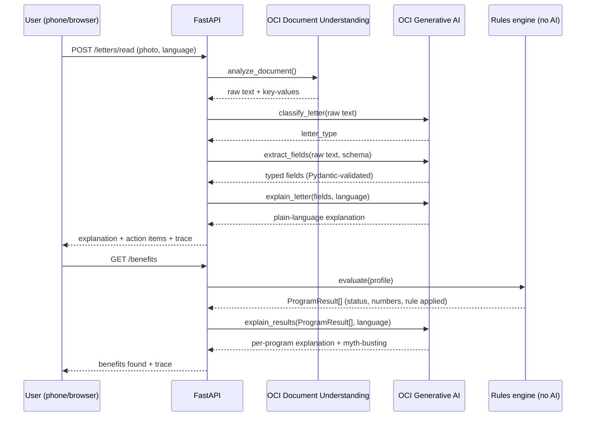

# LetterLens

Multilingual mail assistant for older immigrant New Yorkers. Built for
**#HackTN26 (Oracle)**.

Photograph a confusing English benefits letter (SSA, Medicare, HRA, a
medical bill) → the app explains it in your language → it uses the
extracted facts to:

1. **FIND** unclaimed benefits (Medicare Savings Program, Extra Help, SNAP)
2. **KEEP** benefits (renewal deadlines, document checklists)
3. **PROTECT** against illegal Medicare billing of QMB members
4. **APPLY** for MSP + Extra Help: the app fills in the application from
   the letters, asks only what's missing (by voice, in Mandarin or
   Cantonese), and the user reviews, signs, and says yes

Demo persona: Mei-ling Chen (陈美玲), 74, Flushing, Queens, Mandarin speaker
(the letters in `demo/fixtures/`, walked through in `demo/DEMO_SCRIPT.md`).

## Hard rules this architecture enforces

- **The LLM never decides eligibility.** `app/rules/engine.py` is pure,
  deterministic Python with zero network calls — it is the only place
  eligibility is decided. GenAI only ever extracts, classifies, explains,
  or drafts text.
- **Numbers never drift.** `app/number_guard.py` checks every GenAI output
  against its source facts; any invented number, date, or dollar amount
  raises an error instead of reaching the user.
- **Nothing is sent without the user's explicit yes.** The app fills in
  the application, but it only leaves draft after the user has seen every
  answer (with where it came from), signed, and tapped "Yes, send it for
  me." If documents are missing it goes to a caseworker instead.
- **Submission is simulated, and says so.** No NY State / HRA / SSA API
  accepts third-party filings; every application response carries
  `simulated: true` and the UI shows a "Demo" note. A real launch would
  file through an authorized-representative partner.
- **Sign in before anything personal.** A phone one-time code is required
  for every endpoint that reads or writes someone's letters, benefits,
  reminders or applications -- the user always comes from the sign-in
  token, never from a `user_id` parameter. Sessions last 30 days and are
  revoked on sign-out; code requests are limited to 5 per phone per 15
  minutes. With no SMS provider configured, the code is shown on screen
  (`DEMO_MODE=true`), so **anyone can sign in as any number in demo
  mode** -- turn that off once a real SMS sender is wired into
  `app/auth/service.py` `send_code()`.
- **Unknown is not zero.** A fact nobody has given us (income, Medicare,
  marriage, household size, age, savings) is never treated as $0 or "no".
  The program comes back "More information needed", the app asks exactly
  those questions (`/benefits` -> `questions`, answered via
  `POST /profile/answers`), and every answer is validated by type.
- **Real uploads never become sample data.** Outside `MOCK_MODE`, if
  reading a letter fails the upload fails with a retryable error and
  nothing is saved. `MOCK_MODE` letters are stored with `is_sample` and
  labeled "Sample" everywhere they appear.
- **Uploaded is not verified.** A document photo only counts as
  "uploaded" -- photos are discarded, so nobody can check them later. An
  application only goes out directly when every document was verified by
  a caseworker who saw the original; otherwise it goes to the caseworker
  queue, where they tick what they checked.
- **English and Chinese everywhere.** Every message the user sees has an
  English and a Chinese version, including the backend's rules,
  warnings, to-do items and bill-check reasons (written side by side in
  `app/rules/engine.py` from the same numbers -- a test checks every
  dollar amount matches). The UI is also fully translated into Korean,
  Spanish and Russian; backend-generated text in those languages is
  English in `MOCK_MODE` and translated by OCI GenAI in real mode.
- **Every FIND result shows its work**: numbers used, rule applied, a
  confidence label, and "Final decision is made by NY State / HRA / SSA."
- **MOCK_MODE=true by default.** The entire stack — OCR, classification,
  extraction, explanation, translation, dispute-letter drafting — runs
  fully offline with deterministic canned responses. No OCI credentials
  are required to run or demo this project.
- **Photos are processed temporarily and never saved; facts only after the
  user confirms them.** `POST /letters/read` reads a photo and returns a
  signed draft without writing anything; `POST /letters/confirm` saves
  only the confirmed facts the app uses (no OCR text, name/address only
  if the user opts in). Uploads are closed and our copy zeroed on
  success, failure and cancellation; logs record error types only.
  "Delete my saved information" (`POST /me/delete-data`) removes a user's
  saved data. Full details, processors, and limits: **docs/PRIVACY.md**.

## Architecture

```
┌──────────────────────────┐
│  React + Vite frontend     │   7 screens, mobile-first, 5 languages
└─────────────┬───────────────┘
              │ HTTP/JSON (CORS)
              ▼
┌──────────────────────────────────────────────────┐
│                    FastAPI app                      │
│   POST /letters/read -> /letters/confirm   GET /letters │
│   GET  /reminders    GET /benefits                    │
└───┬────────────┬─────────────┬─────────────┬───────────┘
    │            │             │             │
    ▼            ▼             ▼             ▼
 app/docs     app/keep     app/protect    app/benefits
 (pipeline)   (reminders)  (QMB bill       (bridges stored
    │                       check)         profile -> rules
    │ OCI Document                         -> explain)
    │ Understanding + GenAI                    │
    │ (classify/extract/explain,               │
    │  mock by default)                        │
    ▼                                          │
    └──────────────┬───────────────────────────┘
                    ▼
         ┌───────────────────────┐
         │   app/rules.engine       │  pure Python, deterministic --
         │   (no LLM, no I/O)        │  the only place eligibility
         └────────────┬──────────────┘  is decided
                       │ ProgramResult[]
                       ▼
         ┌───────────────────────┐
         │   app/explain             │  GenAI explanation + myth-busting,
         │   (number_guard-checked)   │  per program, in user's language
         └────────────┬──────────────┘
                       ▼
         ┌───────────────────────┐
         │ SQLite via SQLModel        │  ProfileRecord / LetterRecord /
         │ (Oracle ADB = stretch swap)│  Reminder -- raw images never stored
         └───────────────────────┘
```

## APPLY: review, sign, submit

```
sign in (phone code)
  -> upload letters          POST /letters/read, then /letters/confirm
  -> "Apply for MSP + Extra Help"       POST /applications   (pre-fills from letters + sign-in)
  -> interview: only missing answers    PUT  /applications/{id}/fields/{key}
       voice (browser speech, zh-CN / zh-HK) or typing; app/apply/normalize.py
       turns "一九五二年三月五日" / "没有" into 1952-03-05 / 0 -- no LLM
  -> review every answer + its source, add document photos, sign
  -> "Yes, send it for me"              POST /applications/{id}/submit
       all documents present  -> submitted (confirmation number + timeline)
       documents missing      -> needs_review -> caseworker queue (/caseworker)
                                   approve -> submitted
                                   request info -> user fixes, resubmits
```

The application form (`app/apply/templates.py`) follows NY's DOH-4328 MSP
application; applying for MSP also gets Extra Help automatically. Document
photos are discarded on upload like letter images -- only "provided" is
recorded.

## OCI services used, and why

| Service | What it does | File : function |
|---|---|---|
| **OCI Document Understanding** | OCR + key-value extraction from the photographed letter | `app/docs/oci_client.py` : `_real_ocr` |
| **OCI Generative AI** — classify | Labels the letter as `ssa_benefit_letter` / `bank_statement` / `hra_renewal_notice` / `medical_bill` / `medicare_notice` / `other` | `app/docs/oci_client.py` : `_real_classify` |
| **OCI Generative AI** — extract | Extracts typed fields per a Pydantic schema for that letter type; one retry on invalid JSON before giving up | `app/docs/oci_client.py` : `_real_extract` |
| **OCI Generative AI** — explain | Plain-language explanation of a letter, or of one benefits result, in the user's language at a ~6th-grade reading level | `app/docs/oci_client.py` : `_real_explain`; `app/explain/oci_client.py` : `_real_explain` |
| **OCI Generative AI** — draft + translate | Drafts the QMB dispute letter and its side-by-side translation | `app/protect/oci_client.py` : `_real_english_letter`, `_real_translate` |
| **OCI Speech** *(stretch, not built)* | Voice questions + read-aloud answers | — |
| **Oracle Autonomous Database** *(stretch, not built)* | Swap-in for SQLite via the `oracledb` driver; `app/models.py` / `app/db.py` would be the only files touched | — |

Every real-mode call above shares one GenAI chat helper (`app/oci_genai.py`)
and has a MOCK_MODE path, independently toggled by the `MOCK_MODE` env var,
so the demo is never blocked by missing credentials or network access. Real mode
has been run end to end against the team's OCI tenancy with
`scripts/check_oci.py` (see Testing below): Document Understanding OCR,
classify, extract, and Chinese explanations, with no mock fallback. Run it
again with your own credentials to confirm each call works in your account.

### Proving it, not just claiming it

The hard rule this whole project turns on is **the LLM never decides
eligibility** — `app/rules/engine.py` does, in pure deterministic Python.
That claim is checked at runtime, not just documented: `app/trace.py` times
every step of both the document pipeline and the benefits check and labels
each one with the OCI service that handled it, or `Rules engine (no AI)`
when it didn't touch AI at all. The frontend renders this as a collapsible
"How this was processed" panel (`frontend/src/components/TracePanel.jsx`)
on the Letter Result and Benefits Found screens — a judge can expand it and
see "Checked eligibility → Rules engine (no AI)" sitting right next to the
OCI-labeled steps, in the running app, not just in this README.



**Privacy**: the raw photographed image never touches disk or the
database — it's read into memory, passed to Document Understanding, and
discarded once extraction finishes (see the hard rules above). No
individual government records are looked up anywhere in this flow; the
rules engine only ever sees what the user uploaded or typed.

## Project layout

```
app/
  rules/        M1 -- pure deterministic eligibility engine (limits, income, engine)
  docs/         M3 -- OCR -> classify -> extract -> merge pipeline, POST/GET /letters
  explain/      M4 -- per-program GenAI explanation + myth-busting
  keep/         M5 -- renewal reminders with countdown, GET /reminders
  protect/      M5 -- QMB illegal-billing check + dispute letter draft
  benefits/     M7 -- bridges stored Profile -> rules engine -> explain, GET /benefits
  auth/         phone one-time-code sign-in, /auth/*
  apply/        application pre-fill, interview answer normalizing, review/sign/
                submit, caseworker queue -- /applications, /review-queue
  models.py     SQLModel tables: ProfileRecord, LetterRecord, Reminder
  db.py         SQLite engine/session (DATABASE_URL-configurable)
  number_guard.py / oci_genai.py   shared helpers used across the GenAI call sites
  main.py       FastAPI app, CORS, router wiring
tests/          250+ tests: rules engine (A-J), document pipeline, explain,
                keep/protect, benefits endpoint, sign-in + applications
demo/           M7 -- fixtures, seed script, full persona walkthrough script
frontend/       M6 -- React + Vite UI: language, sign-in, letters, benefits,
                apply interview / review / status, caseworker queue
main.tf, modules/, schema.yaml, *.tf
                OCI Hackathon Starter Kit Terraform (deployment, not yet wired up)
```

## Setup

### Backend

```bash
python3 -m venv .venv && source .venv/bin/activate   # optional
pip install -r requirements.txt
cp .env.example .env     # defaults already run fully offline
DEMO_MODE=true uvicorn app.main:app --reload --port 8000
```

### Frontend

Needs **Node 22.12 or newer** (`.nvmrc` says 22). Older Node fails with a
confusing "Cannot find native binding" error from rolldown; with
`engine-strict` on, npm now says the real problem.

```bash
cd frontend
npm install
npm run dev
```

Open the printed local URL (typically http://localhost:5173). The frontend
calls the backend through a Vite proxy at `/api` (see `vite.config.js`), so
**on a phone** on the same Wi-Fi just open `http://<laptop-ip>:5173` --
find the IP with `ipconfig getifaddr en0` on a Mac.

## Env vars

Root `.env` (backend, see `.env.example`):

| Var | Default | Purpose |
|---|---|---|
| `MOCK_MODE` | `true` | Run OCR/GenAI fully offline with canned responses |
| `DATABASE_URL` | `sqlite:///letterlens.db` | SQLModel connection string |
| `OCI_CONFIG_PATH` | `~/.oci/config` | Only read when `MOCK_MODE=false` |
| `OCI_CONFIG_PROFILE` | `DEFAULT` | Only read when `MOCK_MODE=false` |
| `OCI_COMPARTMENT_ID` | _(empty)_ | Required when `MOCK_MODE=false` |
| `OCI_GENAI_MODEL_ID` | _(empty)_ | Required when `MOCK_MODE=false` |
| `OCI_REGION` | `us-chicago-1` | Overrides the config file's region (GenAI is only in a few regions) |
| `DEMO_MODE` | _(off)_ | **Set `true` for demos.** Shows the sign-in code on screen (no SMS sender exists yet) and accepts the caseworker key `demo-caseworker`. Off = the server refuses to start until production settings exist. |
| `CASEWORKER_KEY` | _(none)_ | Shared key for `/review-queue`. Required outside demo mode; must not be `demo-caseworker`. |

Frontend `frontend/.env.local` (see `frontend/.env.example`):

| Var | Default | Purpose |
|---|---|---|
| `VITE_API_BASE_URL` | `/api` (proxied to `127.0.0.1:8000`) | Only set to call a backend somewhere else |
| `VITE_CASEWORKER_KEY` | _(dev build: `demo-caseworker`)_ | Pre-fills the key on the `/caseworker` screen |

Never commit `.env` or `.env.local` — both are gitignored.

## Running the tests

```bash
python3 -m pytest -q          # 250+ tests: no servers or network needed; real-OCI parsing is tested with fake SDK responses
cd frontend && npm run build && npm run lint
```

### Real OCI mode

1. `.venv/bin/pip install oci` (not in `requirements.txt`; only real mode needs it).
2. Put an API key in `~/.oci/config` (Console -> profile -> My profile -> API keys).
3. In `.env`: `MOCK_MODE=false`, `OCI_COMPARTMENT_ID`, `OCI_GENAI_MODEL_ID` (a
   **Cohere** chat model, e.g. `cohere.command-a-03-2025`), and
   `OCI_REGION=us-chicago-1` -- this overrides the config file's region, since
   Generative AI only runs in a few regions.
4. `.venv/bin/python scripts/check_oci.py` -- reads `.env` itself and runs the
   real pipeline on a sample letter with no mock fallback: config, GenAI chat,
   Document Understanding OCR, classify, extract, and Chinese explanations.
   Each failure prints the Oracle error plus a hint.
5. Run the app with the same settings:
   `DEMO_MODE=true .venv/bin/uvicorn app.main:app --env-file .env --port 8000` (plain
   `uvicorn` does **not** read `.env`).

In the running app any failed OCI call falls back to the offline answer so
the demo never breaks -- but it's logged (`WARNING letterlens.oci: Real OCI
call failed ...` with the Oracle error) and the "How this was processed"
panel marks that step "(offline fallback)".

## Running the demo

**Option A -- scripted transcript, no browser (fastest, <1s in practice):**

```bash
python3 demo/seed.py        # resets the demo SQLite DB
python3 demo/run_demo.py    # signs in, uploads all 4 sample letters, prints FIND/KEEP/PROTECT/APPLY
```

**Option B -- full UI walkthrough:**

```bash
# terminal 1
DEMO_MODE=true uvicorn app.main:app --port 8000
# terminal 2
cd frontend && npm run dev
```

Open the app, pick 中文, sign in with any 10-digit number (the code is
shown on screen), tap "Take a photo of a letter," and upload
one of the four watermarked SAMPLE images in `demo/`. They're clearly
marked fake documents — `MOCK_MODE` dispatches canned OCR text by
filename keyword, it never reads the pixels, so any renamed copy of these
files will misclassify.

Suggested order (these older sample images are addressed to Chen Yu-lan;
the main demo persona, Mei-ling Chen, uses `demo/fixtures/` instead):

1. `ssa_benefit_letter_sample.jpg` -- gross $1,700/mo explained
2. `bank_statement_sample.jpg` -- $40,000 savings (doesn't count for MSP)
3. `hra_snap_renewal_notice_sample.jpg` -- creates a reminder, deadline 2026-11-15
4. `medical_bill_sample.jpg` -- flagged as a possible illegal charge only
   if the profile's `on_qmb` is set (see note below)
5. "See benefits found" -- QMB / Extra Help (auto via QMB) / SNAP, all "likely"
6. "Apply for MSP + Extra Help" -- 4 of 9 answers pre-filled; answer the
   other 5 by voice; review, sign, "Yes, send it for me"
7. Open `/caseworker` in a second tab -- approve, or request info and
   watch the user's status change

**Known gap:** no letter type extracts age or current QMB enrollment.
Age (plus marriage, household size and work income) now comes from the
application interview and feeds the eligibility check, but only once the
user has answered it -- so the benefits shown before applying assume no
age. Current QMB enrollment is still the manual toggle on Home.
`demo/run_demo.py` sets both directly so FIND reflects the persona from
the start.

## Before presenting: verify the numbers

`app/rules/limits.py` is the single source of truth for every dollar
figure used in FIND (federal poverty level, QMB/QI income limits, Extra
Help income/resource limits, SNAP thresholds, the Medicare Part B
premium). Every row is tagged `VERIFY_BEFORE_DEMO` with a source URL --
these are best-effort 2026 figures, not fetched live. **Confirm each one
against the linked SSA / NY State page before presenting this to judges.**

## Git history

`main` and `letterlens` now point at the same history. `main` started as
the OCI Hackathon Starter Kit Terraform (`main.tf`, `modules/`,
`schema.yaml`) and the app was built separately on `letterlens`; the two
unrelated histories were merged so both are kept. The Terraform is what
you'd use to deploy the app to OCI (Compute + MySQL HeatWave / Autonomous
DB); it isn't wired to the app yet.

App milestones, each built on its own branch and fast-forwarded into
`letterlens`:

`m1-rules-engine` -> `m2-tests` -> `m3-document-pipeline` ->
`m4-explanation-layer` -> `m5-keep-protect` -> `m7-demo-fixtures` ->
`m6-frontend` -> `packet-readiness` -> `ios-pwa` -> `qmb-toggle` ->
`demo-script` -> `design-refresh` -> `oci-trace` -> `oci-readme-docs` ->
`tab-bar-icons` -> `realistic-fixtures` -> `oci-fallback-badge` ->
`msp-slide-deck-crosscheck` -> `msp-checklist` -> sign-in + APPLY
(review/sign/submit, caseworker queue, Chinese persona) -> auth on all
personal endpoints + full English/Chinese coverage

The other remote branches are those milestone snapshots; they are not
kept up to date.
